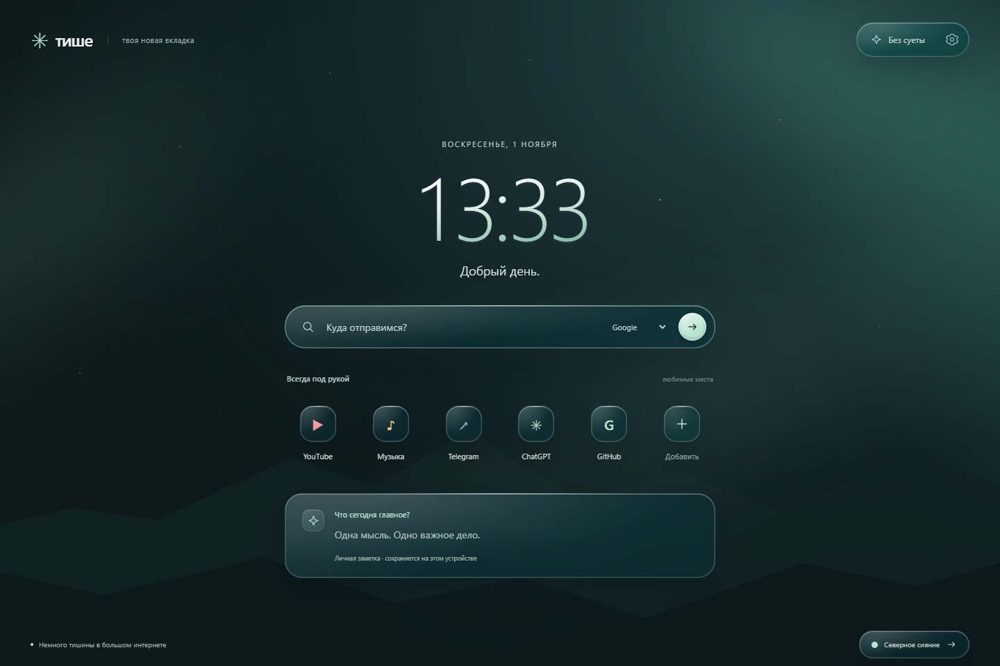

# Тише — спокойная новая вкладка для браузера

Своя спокойная страница вместо стандартной новой вкладки: Liquid Glass, часы, поиск и любимые сайты. Проект рассчитан на настольные браузеры на Chromium: Chrome, Microsoft Edge, Brave, Opera и Vivaldi. Статус проверки каждого браузера указан ниже.

Расширение на русском языке, Manifest V3, без сборки и зависимостей во время работы.



## Возможности

- Три оформления: Север, Сумерки и Рассвет.
- Живое северное сияние и свои картинки, GIF или видео на фоне.
- Полупрозрачные панели, размытие фона и блики за курсором.
- Часы и приветствие по имени.
- Google, Яндекс, Bing и DuckDuckGo в поисковой строке.
- Подсказки выбранного поисковика во время ввода и совпадения из сохранённых ссылок.
- До 17 быстрых ссылок с редактированием.
- Личная заметка с автоматическим сохранением.
- Режим «Без суеты», который скрывает ссылки и заметку.
- Адаптивная вёрстка и поддержка уменьшения движения.

## Совместимость

В коде нет API, специфичных для Edge. Манифест использует стандартный механизм `chrome_url_overrides.newtab`, а интерфейс написан на HTML, CSS и JavaScript.

| Браузер | Что проверено |
| --- | --- |
| Google Chrome | Интерфейс и основные сценарии проверены автоматически в отдельном профиле. Загрузка именно как расширения и живые онлайн-подсказки ещё требуют проверки. |
| Microsoft Edge | Браузер исходной версии. Полную автоматическую проверку установки в этой среде завершить не удалось. |
| Brave, Opera, Vivaldi | Совместимость ожидается по формату Chromium-расширений; отдельная проверка ещё не выполнена. |
| Firefox, Safari | Поддержка пока не заявлена; нужны отдельная подготовка и тестирование. |

Это статус текущей версии, а не гарантия работы во всех перечисленных браузерах. Проверки интерфейса и установки расширения выполняются отдельно.

## Установка

Скачай исходники через **Code → Download ZIP** и распакуй в постоянную папку либо клонируй репозиторий. Для обоих браузеров используется одна и та же папка проекта с `manifest.json`.

### Google Chrome

1. Открой `chrome://extensions`.
2. Включи **Режим разработчика / Developer mode**.
3. Нажми **Загрузить распакованное / Load unpacked** и выбери папку с `manifest.json`.
4. Открой новую вкладку сочетанием **Ctrl + T**. Если браузер запросит подтверждение замены новой вкладки, подтверди использование «Тише».

[Официальная инструкция Chrome](https://developer.chrome.com/docs/extensions/get-started/tutorial/hello-world#load-unpacked).

### Microsoft Edge

1. Открой `edge://extensions`.
2. Включи **Режим разработчика**.
3. Нажми **Загрузить распакованное** и выбери папку с `manifest.json`.
4. Открой новую вкладку сочетанием **Ctrl + T**. Если Edge запросит подтверждение замены новой вкладки, подтверди использование «Тише».

[Официальная инструкция Microsoft](https://learn.microsoft.com/en-us/microsoft-edge/extensions/getting-started/extension-sideloading).

### Остальные браузеры на Chromium

Используй менеджер расширений своего браузера и загрузку распакованной папки в режиме разработчика, если она доступна. Названия пунктов и доступность этой функции зависят от браузера; отдельные инструкции добавим после проверки.

Сохраняй папку на месте, пока расширение установлено. Сборка, Node.js и локальный сервер для использования не нужны.

### Открывать «Тише» при запуске браузера

В настройках запуска браузера выбери открытие страницы новой вкладки. Для этого расширение уже должно быть установлено и включено. В Edge этот раздел доступен по адресу `edge://settings/startHomeNTP`.

## Использование

Нажми шестерёнку справа вверху, чтобы задать имя, выбрать оформление, скрыть часы или отключить онлайн-подсказки. Название пейзажа внизу также переключает тему.

Для добавления сайта нажми **Добавить**. Карандаш на существующей ссылке открывает редактор, где можно изменить адрес, название или удалить ссылку. Адрес без протокола автоматически получает `https://`.

### Свой фон и анимация

В шестерёнке открой **Фон новой вкладки** и выбери один из вариантов:

- **Пейзаж** — неподвижные горы и свет.
- **Живое сияние** — плавная встроенная анимация в цветах выбранной темы, включена по умолчанию.
- **Свой фон** — файл с компьютера: картинка, GIF или видео. Нажми **Выбрать файл**, настрой затемнение и **Сохранить**.

Поддерживаются JPG, PNG, WebP, GIF и AVIF до **20 МБ**, MP4 и WebM до **60 МБ**. Разрешение — до 40 мегапикселей. Поддержка конкретного видеокодека зависит от браузера; если файл не открывается, появится сообщение, а прежний фон сохранится.

Видео зациклено и воспроизводится **без звука**. Кнопка паузы вверху останавливает движение; для GIF и анимированных изображений показывается неподвижный кадр. Анимацию также можно выключить в настройках. При системном уменьшении движения фон неподвижен автоматически. В скрытой вкладке видео и встроенная анимация приостанавливаются.

Фон сохраняется между открытиями вкладок. Выбор файла сам по себе не меняет сохранённый фон: можно закрыть настройки и отменить выбор. **Убрать свой фон → Сохранить** удаляет сохранённый файл и возвращает пейзаж. Переключение на пейзаж или сияние через переключатель сохраняет свой файл для последующего использования.

Изображения заполняют экран по центру; края могут обрезаться при другом соотношении сторон. Затемнение помогает сохранить читаемость текста на светлом фоне.

### Подсказки поиска

Онлайн-подсказки появляются после паузы в наборе в 250 мс, начиная с двух символов. Они работают в поисковой строке страницы расширения; адресная строка самого браузера использует собственные подсказки.

- **↑ / ↓** — выбрать вариант.
- **Enter** — открыть выбранный сайт или выполнить поиск выбранной подсказки. Без выбранного варианта ищет исходный текст.
- **Escape** — закрыть список.
- Можно выбрать вариант мышью.

Полная поисковая выдача открывается на сайте выбранной системы. Если сервис подсказок недоступен, поиск по Enter продолжает работать.

## Данные и разрешения

Имя, тема, ссылки и заметка сохраняются в `localStorage` профиля браузера. Синхронизации между устройствами и резервного копирования нет. Удаление расширения или очистка его данных может удалить настройки.

Свой фон и его неподвижный предпросмотр сохраняются локально в **IndexedDB**, отдельно от файлов расширения. Выбранные картинки и видео не загружаются на сервер и не входят в репозиторий GitHub или архив исходников. Для этой функции не нужны новые разрешения расширения. Очистка данных браузера может удалить фон; после переустановки его может потребоваться выбрать заново.

При включённых онлайн-подсказках набираемый в поисковой строке текст передаётся сервису **выбранной** поисковой системы ещё до Enter. Это можно отключить в настройках. Совпадения из собственных быстрых ссылок продолжат работать без сети.

Для этого в манифесте указан доступ к четырём хостам:

| Система | Сервис подсказок |
| --- | --- |
| Google | `suggestqueries.google.com` |
| Яндекс | `suggest.yandex.net` |
| Bing | `api.bing.com` |
| DuckDuckGo | `duckduckgo.com` |

Запросы подсказок отправляются без cookies и Referer. Набранные запросы и ответы не записываются на диск; ограниченный кэш живёт только в памяти открытой вкладки. Внешних шрифтов, загрузки иконок с сайтов и отдельной аналитики нет. Расширение не запрашивает доступ к истории браузера или содержимому других вкладок.

Сервисы подсказок принадлежат поисковым системам, и их доступность и формат ответа могут меняться.

## Разработка и обновление

Открой исходники в редакторе, измени файлы, затем нажми **↻** на карточке расширения в `chrome://extensions` или `edge://extensions` и открой новую вкладку. При изменении разрешений браузер может запросить подтверждение.

```text
manifest.json     Регистрация новой вкладки и разрешения
newtab.html       Разметка интерфейса
newtab.js         Часы, настройки, ссылки, заметка и поиск
style.css         Вёрстка, темы и пейзаж
glass.css         Стеклянные поверхности
glass.js          Отражения за курсором
search.css        Выпадающий список подсказок
suggestions.js    Запросы подсказок и управление списком
background.css    Анимация сияния и настройки своего фона
background.js     Загрузка медиа, IndexedDB, затемнение и пауза
icons/            Иконки расширения
docs/preview.png  Превью интерфейса
```

Для проверки синтаксиса при установленном Node.js:

```sh
node --check newtab.js
node --check glass.js
node --check suggestions.js
node --check background.js
```

## Проверка и ограничения

Интерфейс проверен автоматически в отдельном профиле Google Chrome: сохранение настроек, работа заметки, редактирование ссылок, поиск, режим «Без суеты», темы и узкий экран.

Подсказки проверены с подменой сетевых ответов: форматы четырёх провайдеров, клавиатура и мышь, задержка запросов, отмена устаревших ответов, ошибки сети, отключение онлайн-подсказок и ввод с IME. Живые ответы провайдеров и установка в пользовательский Edge в этой среде не проверены.

Свой фон проверен в Chrome на PNG, GIF, WebM и MP4: сохранение после перезагрузки, пауза, отмена выбора, затемнение, возврат к пейзажу, удаление файла из IndexedDB, системное уменьшение движения и отклонение неподдерживаемых или повреждённых файлов.

Расширение рассчитано на новую вкладку в обычном окне. Замена новой вкладки в режиме инкогнито Chrome и InPrivate Edge недоступна. Чтобы вернуть стандартную страницу, отключи расширение в менеджере расширений своего браузера.
